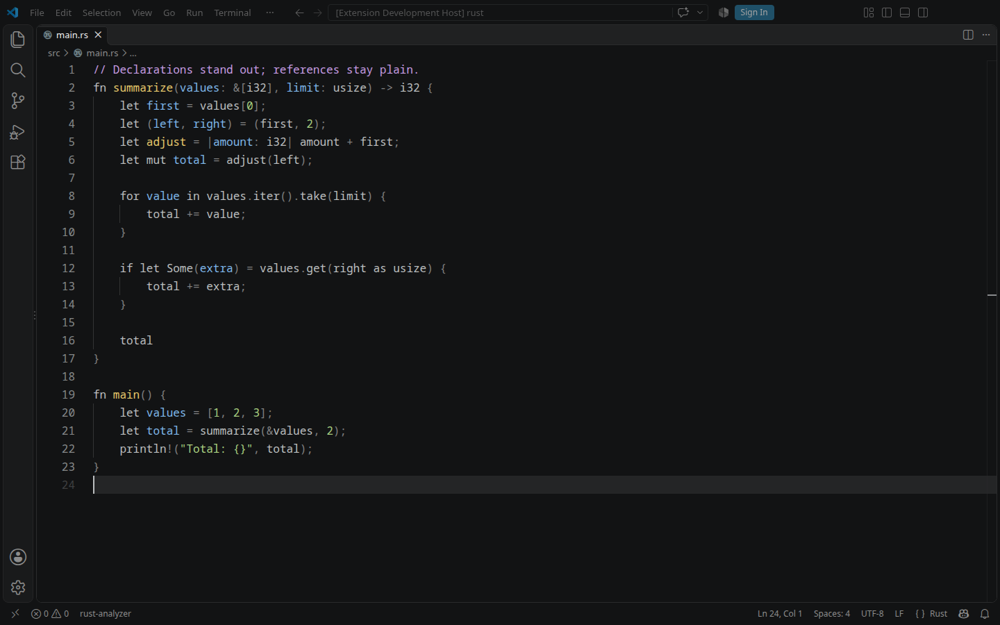
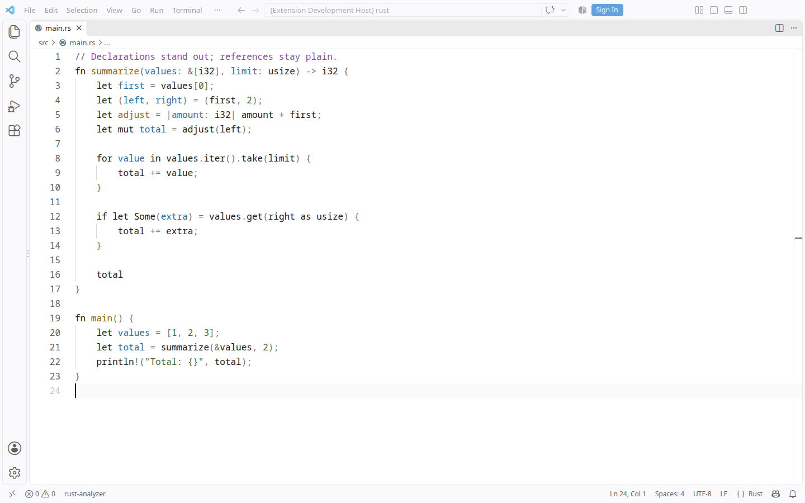

# Still

**VS Code Dark 2026 and Light 2026, with syntax highlighting stripped back to the essentials.** Each appearance keeps its stock editor background, interface, tabs, sidebar, panels, terminal, selections, and other workbench colors.





The highlighting follows the principles in Nikita Prokopov’s [syntax highlighting article](https://tonsky.me/blog/syntax-highlighting/), using four syntax accents:

| Code | Still Dark | Still Light |
| --- | --- | --- |
| References, calls, type references, and keywords | Default text `#BBBEBF` | Default text `#202020` |
| Function and named type declarations | Yellow `#E5C76B` | Ochre `#8A6500` |
| Variable, parameter, and property declarations | Blue `#7EB6E8` | Blue `#1F6FAA` |
| Strings, numbers, and literal values | Green `#A8CF80` | Green `#3C6D2C` |
| Comments | Violet `#C49BE0` | Violet `#8250A0` |
| Punctuation and symbolic operators | Gray `#808080` | Gray `#767676` |

A declaration gets color where a name is introduced; its uses stay plain. Numbers and strings share a color. Comments stand out. Syntax uses no bold or italics. Bracket nesting uses the punctuation color instead of adding more syntax colors.

## Required settings

**Still requires semantic highlighting to distinguish declarations from references.** Enable it in **User Settings (JSON)**, preserving any existing customization rules:

```jsonc
"editor.semanticHighlighting.enabled": true,
"editor.semanticTokenColorCustomizations": {
  "enabled": true
}
```

These settings apply to every color theme. Remove any language-specific override that disables semantic highlighting. See VS Code’s [semantic highlighting guide](https://code.visualstudio.com/api/language-extensions/semantic-highlight-guide#enablement-of-semantic-highlighting).

## Language support

Semantic highlighting uses a language server’s `declaration` and `definition` modifiers. Ordinary semantic tokens use the default editor foreground, including library symbols and readonly references. For Rust, **rust-analyzer must also be running**. The built-in Rust TextMate grammar does not distinguish local declarations or function/closure parameters from their uses. Still colors their `declaration` or `definition` semantic modifiers blue. Closure bindings use the function-definition color; references remain plain.

The TextMate fallback is deliberately conservative. It colors declarations only when the grammar identifies them separately from references. Regression tests use the actual grammars bundled with VS Code:

- JavaScript and TypeScript: function, method, parameter, variable, and supported named type declarations.
- Python: function, class, and parameter declarations. Assignment targets need semantic information from a language extension.
- Rust fallback: function and named type declarations. With rust-analyzer and semantic highlighting enabled: local bindings, tuple/pattern bindings, function and closure parameters, loops, and closure definitions.
- Clojure: global definitions. Its bundled grammar does not distinguish function definitions from other global definitions, local bindings from references, or discarded forms from active code.

Other languages get the same baseline and semantic rules, but declaration coverage depends on their grammar and language extension. A theme cannot reliably distinguish explanatory comments from commented-out code unless the grammar exposes that distinction. Explicit discard/inactive-comment scopes are gray when available.

## Install

Requires VS Code 1.142 or later. Building requires Node.js 22 or later.

```sh
npm ci
npm run package
code --install-extension ./still-theme-0.6.0.vsix --force
```

Select **Still Dark** or **Still Light** in **Preferences: Color Theme**. The extension ID is `scristobal.still-theme`.

### Settings only

To use Still without installing the extension, apply [`still-settings.jsonc`](still-settings.jsonc). It reproduces both appearances as color customizations on VS Code’s built-in themes. Merge its three settings into **User Settings (JSON)**, keeping any existing entries under the same keys, then select **Dark 2026** or **Light 2026** in **Preferences: Color Theme**.

The file enables semantic highlighting for those two themes. An explicit `"editor.semanticHighlighting.enabled": false`, including a language-specific one, still turns it off.

## Development

```sh
npm run build
npm run check
npm test
```

`src/dark-2026.json` and `src/light-2026.json` contain the resolved workbench colors from VS Code 1.142.0’s built-in Dark 2026 and Light 2026 themes, including their Modern, Plus, and Visual Studio theme inheritance. They contain no inherited syntax rules. `src/theme.mjs` preserves those colors and replaces only syntax bracket colors. Edit syntax roles in `src/palettes.mjs` and rules in `src/highlighting.mjs`.

`npm run build` also writes `still-settings.jsonc` from the same rules. Customizations cannot remove the stock themes’ syntax rules, so `src/settings.mjs` restates every stock selector with the color Still gives it, alone and inside the scopes that wrap other tokens, such as strings, comments, declarations, and interpolations. The stock selectors come from `src/dark-2026-syntax.json` and `src/light-2026-syntax.json`, the 2026 themes’ resolved syntax rules.

Tests compare every workbench color and syntax rule with the corresponding installed 2026 theme and check declaration/reference pairs using VS Code’s actual JavaScript, TypeScript, Python, Rust, and Clojure grammars. They also apply `still-settings.jsonc` to the installed stock themes and check that the playgrounds, fixtures, and README render exactly as they do in Still. Set `VSCODE_APP_ROOT` to your installation’s `resources/app` directory if needed. `npm run check` checks generated output, including `still-settings.jsonc`, and syntax contrast.

The Rust fixture in `tests/fixtures/rust/` exercises parameter declarations, locals, tuple bindings, closures, loop bindings, and `if let`. Open that folder with rust-analyzer enabled to check declaration colors against their plain references. Both appearances were verified using the actual rust-analyzer semantic tokens and rendered VS Code colors, including the settings that previously suppressed them.

Press **F5** to launch **Preview Still**. Review `playground.ts` with semantic highlighting both enabled and disabled: declarations get color, while calls and references stay plain. Use **Developer: Inspect Editor Tokens and Scopes** to inspect a token.

## Origin and license

Still is maintained by [Samuel Cristobal](https://github.com/scristobal). Its workbench colors come from Microsoft’s [VS Code default themes](https://github.com/microsoft/vscode/tree/main/extensions/theme-defaults), under the MIT license. The syntax rules follow the article above.

The project began as an independent fork of [Alabaster for VS Code](https://github.com/tonsky/vscode-theme-alabaster) by Nikita Prokopov. Its Git history, [upstream changelog](UPSTREAM_CHANGELOG.md), and copyright notice are retained.

[MIT License](LICENSE.txt).
